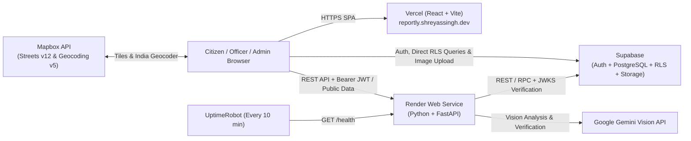

# Reportly Urban

> **Report. Track. Resolve. Verify.**  
> AI-Powered Urban Issue Reporting and Public Accountability Platform

[](https://reportly.shreyassingh.dev)
[](https://github.com/shreyas-650/Reportly-Urban)
[](./frontend)
[](./backend)
[](./supabase)

Reportly Urban enables citizens to report civic infrastructure problems (potholes, garbage accumulation, broken streetlights, water leakage, drainage blockages, and public infrastructure defects), uses Google Gemini Vision for advisory classification and before-and-after verification, routes grievances to municipal departments and officers, enforces SLA deadlines and escalations, and publishes sanitized transparency metrics on a live public accountability dashboard and map.

---

## Table of Contents

- [Live Demo & Screenshots](#live-demo--screenshots)
- [Features](#features)
- [Tech Stack](#tech-stack)
- [Architecture](#architecture)
- [Local Setup](#local-setup)
  - [Prerequisites](#prerequisites)
  - [Environment Variables](#environment-variables)
  - [Database Setup (Supabase Migrations)](#database-setup-supabase-migrations)
  - [Backend Setup](#backend-setup)
  - [Frontend Setup](#frontend-setup)
  - [Running Tests & Build](#running-tests--build)
- [Admin User Setup (Important)](#admin-user-setup-important)
  - [Promoting a Citizen to Admin](#promoting-a-citizen-to-admin)
  - [Creating an Officer & Assigning Department / Ward](#creating-an-officer--assigning-department--ward)
- [Deployment Guide](#deployment-guide)
- [Troubleshooting (Deployment Issues & Fixes)](#troubleshooting-deployment-issues--fixes)
- [Limitations & Notes](#limitations--notes)
- [Project Structure](#project-structure)
- [Roadmap](#roadmap)
- [Contributing](#contributing)
- [License](#license)
- [Author](#author)

---

## Live Demo & Screenshots

- **Production Web App:** [https://reportly.shreyassingh.dev](https://reportly.shreyassingh.dev)
- **Repository:** [https://github.com/shreyas-650/Reportly-Urban](https://github.com/shreyas-650/Reportly-Urban)

> **Screenshots / Demo Walkthrough Placeholder**  
> Add your deployed screenshots or walkthrough GIFs in this section (for example stored under `docs/assets/`):
> - `[Citizen Report Form + India Map Picker]`
> - `[Public Accountability Dashboard & Issue Map]`
> - `[Municipal Admin Triage, Escalations & Before/After Verification]`

---

## Features

### Citizen Portal
- **Issue Reporting with Photo & Map Pin (`/report`):** Upload civic photographs (EXIF/GPS metadata stripped client-side before upload), pin coordinates on an interactive Mapbox map or auto-detect GPS, and submit safely using RFC 4122 UUID v4 `idempotency_key` protection.
- **Advisory AI Issue Detection:** Optional Gemini Vision analysis suggests complaint category, title, description, and priority; citizens review and confirm before submitting.
- **Citizen Dashboard & Resolution Verification (`/dashboard`):** Track personal complaint timelines, view follow-up notices, and **verify** or **dispute** completed work (with server-enforced reopen limits and SLA restarts).
- **Public Transparency Modules (`/issues`, `/map`, `/accountability`):** Browse non-rejected complaints, filter the interactive issue map, and inspect ward-level and department-level metrics with privacy thresholds (small ward groups suppressed cleanly).
- **Citizen Rewards (`/rewards`):** Points, badges, challenges, and ward leaderboards for verified complaints (strictly citizen-only and **feature-flagged `OFF` by default**).

### Officer & Municipal Admin Console
- **Officer Workspace (`/officer`, `/officer/complaints/:id`):** View assigned complaints, pre-deadline/overdue SLA reminders, escalation notices, and resolve issues by uploading mandatory completion photographs.
- **Admin Triage & Department/Officer Management (`/admin`, `/admin/departments`, `/admin/officers`):** Manage municipal departments, verify/assign officers, and configure status transitions without exposing unauthorized private PII.
- **SLA Rules & Multi-Level Escalations (`/admin/sla-rules`, `/admin/escalations`):** Category-specific resolution deadlines, advisory reminders, automatic/manual `+1` level escalations (Level 1 Officer -> Level 2 Department Head -> Level 3 Admin), and `pg_cron` / `/api/internal/sla-sweep` scheduling support.
- **Before-and-After Verification & Disputes (`/admin/disputes`):** Advisory Gemini Vision comparison between initial and completion photos (never independently guarantees physical completion) plus dispute audit queues.
- **AI Triage, Screening & Accuracy (`/admin/duplicates`, `/admin/screening`, `/admin/accuracy-appeals`):** Proximity/text duplicate detection and flagging, suspicious-claim screening (`SCREENING_MODE=shadow` default), department/officer auto-assignment (`shadow` mode default), ward accuracy metrics, and citizen appeal review (`APPEAL_FEATURE_ENABLED=false` default).

### Geospatial & Security Controls
- **India-Only Geospatial Lock:** Enforces India coordinates (`latitude 6.0..37.6`, `longitude 68.0..97.6`) across interactive map `maxBounds`, `minZoom: 4.5`, Mapbox `country=in` geocoding + non-`'in'` country rejection, form/service validation, `/map` display filtering of legacy out-of-India rows, and a `BEFORE INSERT OR UPDATE OF latitude, longitude` PostgreSQL trigger (`trg_guard_complaints_india_bounds`).
- **Role-Based Security & RLS:** Strict separation across `citizen`, `officer`, and `admin` roles enforced via Supabase Row Level Security (RLS), `SECURITY DEFINER` PostgreSQL RPCs (`SET search_path = ''`), and FastAPI ES256 JWKS token verification.

---

## Tech Stack

| Layer | Technology |
|---|---|
| **Frontend** | React 18, Vite 6, JavaScript, Tailwind CSS, React Router v6, Lucide React, Mapbox GL JS (`mapbox-gl`) |
| **Backend** | Python, FastAPI, Pydantic v2, HTTPX, PyJWT (`ES256` JWKS), Pillow |
| **Database & Auth** | Supabase PostgreSQL, Supabase Auth, Row Level Security (RLS), PL/pgSQL triggers & RPCs |
| **AI & Storage** | Google Gemini Vision (`google-genai`, `gemini-2.5-flash`), Supabase Storage (`complaint-images` bucket) |
| **Hosting & Ops** | Vercel (Frontend + Custom Domain), Render (Backend Web Service), Supabase (DB/Auth/Storage), UptimeRobot (Keep-alive) |

> **Documentation Note (`AGENTS.md` vs Codebase):** `AGENTS.md` still references Leaflet/OpenStreetMap and Cloudinary from early planning, whereas the active implementation uses **Mapbox GL JS** and **Supabase Storage (`complaint-images`)**. `AGENTS.md` will only be updated upon explicit approval.

---

## Architecture



---

## Local Setup

### Prerequisites
- **Node.js** v18+ and **npm**
- **Python** 3.11+
- **Supabase** project (URL, `anon` public key, and `service_role` secret)
- **Google Gemini API key** (from Google AI Studio)
- **Mapbox** public access token (`pk.*`)

### 1. Clone the Repository

```bash
git clone https://github.com/shreyas-650/Reportly-Urban.git
cd Reportly-Urban
```

### 2. Environment Variables

> Never commit `.env`, `backend/.env`, `frontend/.env`, API keys, or `SUPABASE_SERVICE_ROLE_KEY`. Root `.gitignore` ignores all `.env` files.

#### Frontend Variables (`frontend/.env` — public `VITE_*` values baked into build)

Source template: [`frontend/.env.example`](./frontend/.env.example)

| Variable | Required | Secret? | Example | Description |
|---|---|---|---|---|
| `VITE_SUPABASE_URL` | Yes | No | `https://<project-ref>.supabase.co` | Supabase project API URL |
| `VITE_SUPABASE_ANON_KEY` | Yes | No | `<your-supabase-anon-key>` | Supabase `anon` public key (never use `service_role` in frontend) |
| `VITE_MAPBOX_ACCESS_TOKEN` | Yes | No | `<your-mapbox-pk-token>` | Mapbox public token starting with `pk.` |
| `VITE_AI_SERVICE_URL` | Yes | No | `http://localhost:8000` | Base URL of the FastAPI backend (no trailing slash) |
| `VITE_API_BASE_URL` | No | No | `http://localhost:8000` | Optional fallback alias read by `complaintService.js` when `VITE_AI_SERVICE_URL` is unset |

#### Backend Variables (`backend/.env` — server-only secrets & configuration)

Source template: [`backend/.env.example`](./backend/.env.example) and [`backend/app/config.py`](./backend/app/config.py)

| Variable | Required | Secret? | Default / Example | Description |
|---|---|---|---|---|
| `SUPABASE_URL` | Yes | No | `https://<project-ref>.supabase.co` | Supabase project URL (`VITE_SUPABASE_URL` also accepted by `config.py`) |
| `SUPABASE_ANON_KEY` | Yes | No | `<your-supabase-anon-key>` | Used by `auth_service.py` for profile/officer verification (`VITE_SUPABASE_ANON_KEY` fallback only works locally if `frontend/.env` exists) |
| `SUPABASE_SERVICE_ROLE_KEY` | Yes | **Yes** | `<your-supabase-service-role-key>` | Service role credential for backend RPCs and quota tracking |
| `GEMINI_API_KEY` | Yes | **Yes** | `<your-gemini-api-key>` | Google Gemini Vision API key |
| `GEMINI_MODEL` | No | No | `gemini-2.5-flash` | Gemini model ID |
| `CORS_ORIGINS` | Yes | No | `http://localhost:5173,http://127.0.0.1:5173` | Comma-separated exact origins (no quotes, no wildcards, no trailing slash) |
| `ENVIRONMENT` | No | No | `development` / `production` | Runtime environment identifier |
| `TRUSTED_PROXY_HOPS` | Prod: Yes | No | `0` (local) / `1` (Render) | Number of trusted reverse proxies before reading `X-Forwarded-For` |
| `SLA_SWEEP_SECRET` | Internal cron | **Yes** | `<32+-char-random-secret>` | Secret header `X-Sweep-Secret` for `POST /api/internal/sla-sweep` |
| `GLOBAL_DAILY_AI_CAP` | No | No | `500` | Global daily Gemini call cap for citizen detection |
| `USER_DAILY_AI_LIMIT` | No | No | `10` | Per-citizen daily Gemini call cap |
| `AI_RESOLUTION_CHECK_ENABLED` | No | No | `false` | Enables Phase 8.2 advisory before-and-after image comparison |
| `AI_INTELLIGENCE_ENABLED` | No | No | `false` | Enables Phase 9.1 shadow AI suggestions |
| `DEPARTMENT_AUTO_ASSIGN_MODE` | No | No | `shadow` | `off` \| `shadow` \| `active` |
| `OFFICER_AUTO_ASSIGN_MODE` | No | No | `shadow` | `off` \| `shadow` \| `active` |
| `SCREENING_MODE` | No | No | `shadow` | Phase 9.5 claim screening mode (`off` \| `shadow` \| `active`) |
| `SCREENING_CITY_BBOX_*` | No | No | Unset | Optional city operational bbox (`MIN_LAT`, `MAX_LAT`, `MIN_LNG`, `MAX_LNG`) separate from the India lock |
| `APPEAL_FEATURE_ENABLED` | No | No | `false` | Enables citizen screening appeals (`Phase 9.6`) |
| `REWARDS_FEATURE_ENABLED` | No | No | `false` | Enables citizen rewards endpoints (`Phase 10`, off by default) |

> **Storage Note:** Photo uploads go to Supabase Storage (`complaint-images` bucket defined in `frontend/src/services/storageService.js`). There are **no Cloudinary environment variables** in `backend/.env.example` or `frontend/.env.example`.

Additional fine-grained tuning thresholds (rate limits, cooldowns, duplicate detection radius/window, leaderboard minimum group size, timezone) are documented in [`backend/.env.example`](./backend/.env.example).

### 3. Database Setup (Supabase Migrations)

Run every SQL file inside [`supabase/migrations/`](./supabase/migrations) **in chronological filename order** in the **Supabase SQL Editor**:

1. `20261123_phase2_init_schema.sql` through `20261212_phase10_citizen_rewards.sql`
2. `20261213_india_geospatial_bounds.sql` *(adds the `BEFORE INSERT OR UPDATE OF latitude, longitude` India bounds trigger without touching existing rows)*

Corresponding down/rollback scripts for Phases 7.4–10 and the India geospatial trigger are located in [`supabase/rollbacks/`](./supabase/rollbacks) (`*_UNDO.sql`).

### 4. Backend Setup

```bash
cd backend
python -m venv .venv
```

Activate the virtual environment and install dependencies:

- **Windows (PowerShell):**
  ```powershell
  .\.venv\Scripts\Activate.ps1
  pip install -r requirements.txt
  copy .env.example .env
  ```
- **macOS / Linux:**
  ```bash
  source .venv/bin/activate
  pip install -r requirements.txt
  cp .env.example .env
  ```

Fill in `SUPABASE_URL`, `SUPABASE_ANON_KEY`, `SUPABASE_SERVICE_ROLE_KEY`, and `GEMINI_API_KEY` inside `backend/.env`, then start the API server:

```bash
uvicorn app.main:app --reload --port 8000
```

Verify locally at `http://localhost:8000/health` or `http://localhost:8000/docs`.

### 5. Frontend Setup

```bash
cd frontend
npm install
```

Copy [`frontend/.env.example`](./frontend/.env.example) to `frontend/.env`, populate `VITE_SUPABASE_URL`, `VITE_SUPABASE_ANON_KEY`, `VITE_MAPBOX_ACCESS_TOKEN`, and `VITE_AI_SERVICE_URL=http://localhost:8000`, then run:

```bash
npm run dev
```

The frontend runs at `http://localhost:5173`.

### 6. Running Tests & Production Build

- **Backend unit & mocked integration tests (`backend/`):**
  ```bash
  cd backend
  python -m unittest discover tests
  ```
- **Frontend Vitest suite (`frontend/`):**
  ```bash
  cd frontend
  npm test -- --run
  ```
- **Frontend production build (`frontend/`):**
  ```bash
  cd frontend
  npm run build
  ```

> **Safety Warning:** Do not run `supabase/tests/phase7_2_live.test.js` or `POST /api/internal/sla-sweep` casually against a live database with legacy `NULL sla_deadline` rows, as it processes overdue complaints.

---

## Admin User Setup (Important)

- All new self-registered accounts default to `role = 'citizen'`. **Admins cannot be created or promoted from the frontend UI.**
- The `guard_profile_updates()` trigger (defined in [`20261124_phase4_2_admin_complaint_management.sql`](./supabase/migrations/20261124_phase4_2_admin_complaint_management.sql#L150-L179)) **blocks** any direct update to `public.profiles.role = 'admin'` unless the caller holds database owner (`postgres` / `supabase_admin`) or backend `service_role` credentials.
- Use the built-in stored procedure [`public.provision_admin_user(TEXT)`](./supabase/migrations/20261124_phase4_1_admin_officer_authorization.sql#L308-L399) in the **Supabase SQL Editor**:

### Promoting a Citizen to Admin

1. Have the user register a normal account first (so a row exists in both `auth.users` and `public.profiles`).
2. Open **Supabase Dashboard -> SQL Editor** (runs as `postgres`) and execute:

```sql
CALL public.provision_admin_user('admin-user@example.com');
```

This atomically verifies the user in `auth.users` and `public.profiles`, promotes `role` to `'admin'`, and writes an immutable entry to `public.admin_promotion_audit`.

> **Security Warning:** Never place `SUPABASE_SERVICE_ROLE_KEY` in frontend code, Vite variables, screenshots, or Git commits.

> If you are unsure how to set up an admin user, ask the maintainer or open an issue.

### Creating an Officer & Assigning Department / Ward

1. Have the staff member sign up as a normal user (`role = 'citizen'`).
2. Sign in as an **Admin** and open **`/admin/officers`**.
3. Use the officer provisioning form, which calls the admin-only RPC [`public.link_officer_user(p_user_email, p_department_id, p_official_name, p_designation, p_assigned_ward)`](./supabase/migrations/20261124_phase4_2_admin_complaint_management.sql#L748-L881):
   - Verifies the caller passes `public.is_admin()`.
   - Verifies the target department is active and locks the citizen's `public.profiles` row.
   - Promotes `profiles.role` from `'citizen'` to `'officer'` and inserts the verified staff record into `public.officers` with department and ward assignment.

---

## Deployment Guide

**Production Topology:** **Vercel** (Frontend) + **Render Free Web Service** (Backend) + **Supabase** (DB/Auth/Storage) + **UptimeRobot** (10-minute keep-alive ping).

### Step 1: Supabase
1. Run all SQL migrations from [`supabase/migrations/`](./supabase/migrations) (including `20261213_india_geospatial_bounds.sql`).
2. Go to **Authentication -> URL Configuration**:
   - **Site URL:** `https://reportly.shreyassingh.dev`
   - **Redirect URLs:** `https://reportly.shreyassingh.dev/**` *(and optionally `http://localhost:5173/**` for local development)*

### Step 2: Render Backend (`backend/`)
1. Create a **New -> Web Service** from the GitHub repository:
   - **Root Directory:** `backend`
   - **Runtime:** Python 3
   - **Build Command:** `pip install -r requirements.txt`
   - **Start Command:** `uvicorn app.main:app --host 0.0.0.0 --port $PORT`
   - **Instance Type:** Free
   - **Health Check Path:** `/health`
2. Configure **Environment Variables** in Render:
   - `PYTHON_VERSION` *(e.g. `3.12.x` if pinning Python on Render)*
   - `SUPABASE_URL` = `<your-supabase-url>`
   - `SUPABASE_ANON_KEY` = `<your-supabase-anon-key>` *(explicitly required on Render!)*
   - `SUPABASE_SERVICE_ROLE_KEY` = `<your-supabase-service-role-key>`
   - `GEMINI_API_KEY` = `<your-gemini-api-key>`
   - `GEMINI_MODEL` = `gemini-2.5-flash`
   - `CORS_ORIGINS` = `https://reportly.shreyassingh.dev` *(no quotes, no trailing slash; comma-separate if multiple)*
   - `ENVIRONMENT` = `production`
   - `TRUSTED_PROXY_HOPS` = `1`
   - `SLA_SWEEP_SECRET` = `<random-string-at-least-32-chars>`
   - Keep staged rollout flags at safe defaults: `REWARDS_FEATURE_ENABLED=false`, `APPEAL_FEATURE_ENABLED=false`, `SCREENING_MODE=shadow`, `DEPARTMENT_AUTO_ASSIGN_MODE=shadow`, `OFFICER_AUTO_ASSIGN_MODE=shadow`
3. Deploy and verify `https://<render-service>.onrender.com/health` returns `{"status":"healthy", ...}`.

### Step 3: Vercel Frontend (`frontend/`)
1. Import the GitHub repository into Vercel:
   - **Root Directory:** `frontend`
   - **Framework Preset:** `Vite`
   - **Build Command:** `npm run build`
   - **Output Directory:** `dist`
2. Ensure [`frontend/vercel.json`](./frontend/vercel.json) is committed so SPA refreshes do not 404:
   ```json
   {
     "rewrites": [{ "source": "/(.*)", "destination": "/index.html" }]
   }
   ```
3. Skip Vercel's optional Supabase marketplace integration prompt—add your own Environment Variables instead:
   - `VITE_SUPABASE_URL`
   - `VITE_SUPABASE_ANON_KEY`
   - `VITE_MAPBOX_ACCESS_TOKEN`
   - `VITE_AI_SERVICE_URL` = `https://<render-service>.onrender.com` *(no trailing slash)*
4. Deploy (or **Redeploy** with *"Use existing Build Cache"* unchecked after editing any `VITE_*` variable).

### Step 4: Custom Domain (`reportly.shreyassingh.dev`)
1. In **Vercel -> Project -> Settings -> Domains**, add `reportly.shreyassingh.dev`.
2. Add the DNS `CNAME` record provided by Vercel (`reportly` -> `cname.vercel-dns.com` or target shown by Vercel) in your DNS provider and wait for SSL provisioning.

### Step 5: Mapbox Token URL Restriction
In your Mapbox account dashboard, restrict `VITE_MAPBOX_ACCESS_TOKEN` (`pk.*`) to `https://reportly.shreyassingh.dev/*` *(and `http://localhost:5173/*` if testing locally)*.

### Step 6: UptimeRobot Keep-Alive
On Render Free tier, create an HTTP(S) monitor in **UptimeRobot** (or `cron-job.org`) pinging:
```text
https://<render-service>.onrender.com/health
```
every **10 minutes** so the backend stays warm instead of sleeping after 15 minutes of inactivity.

### Step 7: Post-Deploy Verification
- Sign in and sign out cleanly via Supabase Auth.
- Submit a citizen report with a photo and an Indian map pin (`/report`), and confirm a pin outside India (e.g. outside `6.0..37.6` x `68.0..97.6` or a cross-border coordinate resolving outside `'in'`) is rejected.
- Verify public pages (`/accountability`, `/issues`, `/map`) load metrics and map clusters.
- Verify authenticated Admin pages (`/admin/escalations`, `/admin/sla-rules`, `/admin/disputes`) load without `401` errors.

---

## Troubleshooting (Deployment Issues & Fixes)

| Symptom | Cause | Fix |
|---|---|---|
| Vercel suggests installing the Supabase Integration during setup | Optional marketplace wizard | Skip it and enter your own `VITE_SUPABASE_URL` and `VITE_SUPABASE_ANON_KEY` manually |
| Vercel warns about `VITE_` prefix when creating Sensitive/Secret env vars | Vite exposes all `VITE_*` vars in the public browser bundle | Store `VITE_*` values as normal **Config / Plain** env vars, and never put real secrets (like `SUPABASE_SERVICE_ROLE_KEY` or `GEMINI_API_KEY`) in `VITE_*` |
| `404: NOT_FOUND` on refreshing or directly opening `/accountability`, `/map`, or `/admin` | Client-side React Router SPA requires rewrite rules on Vercel | Keep [`frontend/vercel.json`](./frontend/vercel.json) rewriting `/(.*)` to `/index.html`, and confirm Vercel **Root Directory** is `frontend` |
| `"Failed to fetch"` on `/accountability`, `/issues`, `/map` while login works | Frontend fell back to `http://localhost:8000` because `VITE_AI_SERVICE_URL` was missing, misnamed (`VITE_API_URL`), or added without rebuilding | Set `VITE_AI_SERVICE_URL=https://<render-service>.onrender.com` in Vercel Production env and trigger **Redeploy** with *"Use existing Build Cache"* unchecked |
| DevTools Network shows requests to `onrender.com` with **`Provisional headers are shown`** and no status/response headers | Browser blocked CORS response because `CORS_ORIGINS` was missing on Render, had quotes/trailing slash, or was mistakenly put in Vercel | Set `CORS_ORIGINS=https://reportly.shreyassingh.dev` inside **Render** (not Vercel) with no quotes or trailing `/`, then redeploy Render |
| Admin pages (`/admin/escalations`, `/admin/sla-rules`) say `"Your session has expired or is invalid"` (`401`) while `/accountability` works | `SUPABASE_ANON_KEY` missing on Render (locally the backend loaded `VITE_SUPABASE_ANON_KEY` from `frontend/.env`), or `SUPABASE_URL` had a trailing `/`/space | Add `SUPABASE_ANON_KEY` to **Render** Environment, ensure clean `SUPABASE_URL`, and redeploy Render |
| Opening `https://<render-service>.onrender.com/` directly returns `{"detail":"Not Found"}` | FastAPI intentionally has no `/` root route | Verify backend health at `/health` or `/docs` instead |
| Render fails to install packages or boot the server | Wrong Render Language (Node instead of Python), wrong Root Directory, or wrong start module | Set Language = Python 3, Root Directory = `backend`, Build = `pip install -r requirements.txt`, Start = `uvicorn app.main:app --host 0.0.0.0 --port $PORT` |
| Backend is slow (~45–60s) or times out on first request after idle | Render Free tier spins down after ~15 minutes of inactivity | Configure UptimeRobot to ping `/health` every 10 minutes, or hit `/health` before live demos |
| Uploaded complaint photos disappear on Render restarts? | Render Free tier local disk is ephemeral | Verified safe by design: uploads go directly to **Supabase Storage (`complaint-images`)**, never local Render disk |
| Rewards API returns `403` for officers/admins, or rewards stay hidden | Rewards are strictly citizen-only and off by default (`REWARDS_FEATURE_ENABLED=false`) | Expected behavior; admins use `/admin/rewards`, and citizen rewards stay disabled until intentionally turned on |
| Map visually displays neighbouring countries' landmass inside the India box | Mapbox `streets-v12` tiles render surrounding terrain inside rectangular bounds | Expected tile rendering; out-of-India pins/clicks/GPS are blocked by the UI, geocoder, and PostgreSQL trigger |

---

## Limitations & Notes

- **Render Free Tier Cold Starts:** Without a keep-alive monitor like UptimeRobot, inactive services sleep after ~15 minutes and take ~30–60 seconds on the first wakeup request.
- **Gemini Free-Tier Quotas:** Burst traffic can hit Gemini `429` rate limits; AI classification and screening fail open/gracefully so citizen submissions are never blocked.
- **Shadow / Off Feature Defaults:** Department auto-assignment, officer auto-assignment, and suspicious-claim screening run in `shadow` mode by default; citizen appeals and citizen rewards default to `false` (`OFF`) until enough verified accuracy metrics exist.
- **Pending Roadmap Scope:** Phase `9.7` (narrow objective auto-rejection) remains unimplemented until `9.5` accuracy data establishes a safe verified false-positive rate.
- **Live DB Verification Note:** Ensure [`20261213_india_geospatial_bounds.sql`](./supabase/migrations/20261213_india_geospatial_bounds.sql) is executed in Supabase SQL Editor for database-level enforcement.

---

## Project Structure

```text
Reportly-Urban/
├── frontend/
│   ├── vercel.json                        # Vercel SPA rewrite to /index.html
│   ├── .env.example                       # Public Vite env var template
│   └── src/
│       ├── components/                    # Reusable UI, forms, maps (LocationPickerMap, PublicComplaintsMap)
│       ├── context/                       # AuthContext & ComplaintContext
│       ├── data/                          # Fixed ISSUE_CATEGORIES & WARDS lists
│       ├── layouts/                       # MainLayout & AdminLayout
│       ├── lib/                           # Supabase client initialization
│       ├── pages/                         # Citizen, Officer, Public, and Admin pages
│       ├── services/                      # Supabase, FastAPI, Mapbox, Storage & AI API clients
│       ├── tests/                         # Vitest unit & integration test suites
│       └── utils/                         # Formatting, public map helpers & indiaGeoBounds.js
├── backend/
│   ├── .env.example                       # Backend env var template
│   ├── requirements.txt                   # Python dependencies
│   ├── app/
│   │   ├── config.py                      # Settings & fail-closed env parsing
│   │   ├── main.py                        # FastAPI entry point, CORS & internal origin isolation
│   │   ├── routers/                       # Modular route handlers (ai, public, admin, officer, citizen, internal)
│   │   ├── schemas/                       # Pydantic validation models
│   │   └── services/                      # Auth (JWKS), Gemini, routing, SLA, screening, rewards services
│   └── tests/                             # Python unittest suite
├── supabase/
│   ├── migrations/                        # Sequential PostgreSQL schema, RLS, RPC & trigger migrations
│   ├── rollbacks/                         # Atomic *_UNDO.sql rollback scripts
│   ├── scripts/                           # Helper seed/cleanup SQL scripts
│   └── tests/                             # Node/DB verification scripts
├── docs/
│   └── ROADMAP.md                         # Project phase status & rollout notes
├── AGENTS.md                              # Agent engineering standards & guidelines
└── README.md
```

---

## Roadmap

See [`docs/ROADMAP.md`](./docs/ROADMAP.md) for detailed phase history, rollout notes (`shadow` modes, appeals/rewards default `OFF`), and pending items such as Phase `9.7` and ongoing Phase `11` verification.

---

## Contributing

1. Read [`AGENTS.md`](./AGENTS.md) and [`docs/ROADMAP.md`](./docs/ROADMAP.md) before making architectural or database changes.
2. Follow the additive migration rule—never modify already-applied SQL migrations; create a new timestamped migration in `supabase/migrations/` alongside a matching rollback in `supabase/rollbacks/`.
3. Never commit `.env` files, credentials, or build outputs.
4. Run the full backend suite (`python -m unittest discover tests`), frontend suite (`npm test -- --run`), and `npm run build` before opening a pull request.

---

## License

No `LICENSE` file is currently present in the repository root. If publishing publicly for external use, add a `LICENSE` file (for example MIT) before distribution.

---

## Author

**Shreyas Singh**  
GitHub: [@shreyas-650](https://github.com/shreyas-650)  
Live Deployment: [https://reportly.shreyassingh.dev](https://reportly.shreyassingh.dev)
